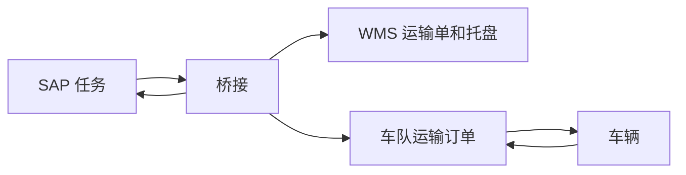

# 整体架构

这条环境看的是一笔搬运任务怎么从 SAP 下到仓库，再交给车队，最后把结果写回 SAP。车辆不真的动。完整版用 openTCS 的 Loopback 驱动沿路线走完并回报；Python 简化版用一个小车辆服务做同样的回报。

仓库里有两套实现，形状相同：

- 完整版：用 SAP CAP 模拟的 EWM 标准接口 `API_WAREHOUSE_ORDER_TASK_2`、OpenWMS、openTCS，中间用 `bridge` 对接。接口细节见 [SAP标准接口.md](SAP标准接口.md)。
- Python 简化版：五个标准库 HTTP 服务，放在 `python-chain` 容器里。接口是简化过的，用来对照任务状态怎么传，不替代上面的真实接口。

调度板 <http://localhost:8080> 把两套画成同样的五个框。框里的文字是该服务当时的返回，不是写死的示例。

## 架构

桥接是唯一同时认识四边的程序。SAP 不调用 WMS，WMS 也不调用车队。车辆只向车队回报位置和动作，不认识 SAP。

完整版里，这五块对应的进程和端口是：

| 架构上的一块 | 进程 | 端口 | 这次它拿出的结果 |
| --- | --- | --- | --- |
| SAP 任务 | `sap`，CAP 模拟 EWM `API_WAREHOUSE_ORDER_TASK_2` | 4004 | 仓库任务 `1000000001` 状态 `C`，仓库单 `2000000001` 状态 `C` |
| 桥接 | `bridge` | 8090 | 「搬运完成，已在 SAP 确认仓库任务」 |
| WMS | `openwms-common` 管库位和托盘，`openwms-tms` 管运输单 | 8120、8131 | 运输单 `FINISHED`，托盘在拣选位 |
| 车队 | `opentcs` 内核，Web API | 55200 | 订单 `SAP-1000000001` 为 `FINISHED` |
| 车辆 | openTCS Loopback 驱动里的 `Vehicle-01` | 含在 55200 | 空闲，停在 `Point-Pick` |

`common-compat` 没有画进这五块。它夹在 TMS 和 Common 之间：TMS 2.0 查库位组时期待一个对象，Common 3.0 不带名字时返回数组，兼容层取其中一个，否则建运输单会 502。

Python 简化版用同一形状，端口错开：

| 架构上的一块 | 代码 | 端口 | 这次它拿出的结果 |
| --- | --- | --- | --- |
| SAP 任务 | `python/chain/sap.py` | 9004 | 任务 `1000000001` 为 `CONFIRMED` |
| 桥接 | `python/chain/bridge.py` | 9090 | 「任务 1000000001 搬运完成，结果已回写 SAP」 |
| WMS | `python/chain/wms.py` | 9120 | 运输单 `TO-0001` 为 `FINISHED` |
| 车队 | `python/chain/fleet.py` | 9200 | 订单 `SAP-1000000001` 为 `FINISHED` |
| 车辆 | `python/chain/vehicle.py` | 9300 | 空闲，停在 `Point-Pick` |

## 仓位和路线

SAP 仓位、OpenWMS 库位、openTCS 位置是三套名字，桥接负责换算。

| SAP 仓位 | OpenWMS 库位 | openTCS 位置 | 路线上的点 |
| --- | --- | --- | --- |
| `IPNT-01` 入库 | `FGIN/IPNT/0001/0000/0000` | `Inbound` | `Point-Inbound` |
| `PICK-01` 拣选 | `FGIN/PICK/WORK/0001/0000` | `Pick-01` | `Point-Pick` |

车辆从 `Point-Park` 出发。完整版的路线是停车到入库，再从入库到拣选。Python 车队用同样三个点。托盘条码两边都是 `00000000000000004711`，类型 `PALLET`。

完整版的状态沿同一条线对齐。EWM 仓库任务只有未清、已确认、已取消三种，没有「执行中」，所以车辆跑的时候 SAP 仍是未清：

| 阶段 | SAP 仓库任务 | WMS | 车队 |
| --- | --- | --- | --- |
| 等待接手 | 未清 `''` | | |
| 车辆正在执行 | 未清 `''` | `STARTED` | `BEING_PROCESSED` |
| 卸货完成并确认 | `C` | `FINISHED` | `FINISHED` |

取消和失败：在 SAP 调用 `CancelWarehouseTask` 后任务为 `A`，桥接撤回车队订单（变成 `FAILED`）并把 WMS 置为 `CANCELED`。车队失败时标准接口没有回写异常的动作，SAP 保持未清，WMS 置为 `ONFAILURE`，桥接停手等人处理。下面这个 case 没有走这两条。

Python 简化版的 SAP 仍是自定义接口：`RELEASED` → `IN_PROCESS`（交接）→ `CONFIRMED`，只做正常完成。

## Case：任务 1000000001

这是启动后自动跑完的一笔。预制数据在 `sap/db/data/sap.ewm-WarehouseTasks.csv` 和 `sap.ewm-WarehouseOrders.csv`。

| 字段 | 值 |
| --- | --- |
| 仓库号 `EWMWarehouse` | `E001` |
| 仓库任务 `WarehouseTask` / `WarehouseTaskItem` | `1000000001` / `0` |
| 仓库单 `WarehouseOrder` | `2000000001` |
| 仓库流程类型 `WarehouseProcessType` | `9999` |
| 物料 `Product` | `MAT-100`，数量 1 `EA` |
| 仓位 | `IPNT-01` → `PICK-01` |
| 源处理单元 `SourceHandlingUnit` | `00000000000000004711`，就是这只托盘 |
| 启动时状态 | 未清 `''` |

下面的单号取自 2026-11-08 19:25 这次运行。任务号、仓位、托盘、车队订单名每次启动都一样。OpenWMS 运输单主键在容器重建后会换成新的 UUID。

### 完整版怎么走完这一笔

1. **SAP。** 桥接请求 `GET .../warehouseorder/0001/WarehouseTask?$filter=WarehouseTaskStatus eq ''`，拿到 `1000000001`。
2. **WMS。** 桥接确认入库位、拣选位和托盘存在，把托盘放在 `FGIN/IPNT/0001/0000/0000`，再 `POST /v1/transport-orders`，目标库位是 `FGIN/PICK/WORK/0001/0000`。这次返回的运输单是 `b82c9d07-249c-43b0-b6b4-f1e2293f5c99`，随后被置为 `STARTED`。桥接把这个对照记在自己的 `links` 里。
3. **车队。** 桥接 `POST /v1/transportOrders/SAP-1000000001`。第一段到 `Inbound` 做 `Load cargo`，第二段到 `Pick-01` 做 `Unload cargo`，指定车辆 `Vehicle-01`。openTCS 把订单派给这辆车，Loopback 从 `Point-Park` 走到 `Point-Inbound`，再走到 `Point-Pick`。这段时间里，桥接每轮都会 `GET` 一次这个仓库任务，看 SAP 有没有取消。
4. **结束。** 车队订单变成 `FINISHED` 后，桥接把 WMS 运输单改为 `FINISHED`，托盘位置变成 `FGIN/PICK/WORK/0001/0000`。然后读任务拿 ETag，取 CSRF 令牌，调用 `WarehouseTask(EWMWarehouse='E001',WarehouseTask='1000000001',WarehouseTaskItem='0')/SAP__self.ConfirmWarehouseTaskExact`，请求体 `{"DirectWhseTaskConfIsAllowed":true}`。任务变为 `C`，实际数量 1；仓库单 `2000000001` 下没有别的任务，自动变为 `C`。从接手到确认大约 25 秒。桥接日志是「搬运完成，已在 SAP 确认仓库任务」。车辆状态 `IDLE`，位置 `Point-Pick`。

SAP 里没有存外部单号。要回查 WMS，先在 <http://localhost:8090/status> 的 `links` 里找到 `1000000001` 对应的运输单，再打开：

`http://localhost:8131/v1/transport-orders/b82c9d07-249c-43b0-b6b4-f1e2293f5c99`

返回的 `state` 是 `FINISHED`，`transportUnitBK` 是这只托盘，源库位和目标库位就是上面两个仓位。

### 同一笔在 Python 里

Python 不调用 4004 和 8131。它自己的 SAP 是自定义接口，里面有一笔同号、状态 `RELEASED` 的任务，桥接按同样的顺序做：

1. 在模拟 WMS 建运输单 `TO-0001`，源 `FGIN/IPNT/0001/0000/0000`，目标 `FGIN/PICK/WORK/0001/0000`，并改为 `STARTED`。
2. 在模拟车队建 `SAP-1000000001`，两段仍是 Inbound 装货、Pick-01 卸货。
3. 模拟 SAP 做交接，变成 `IN_PROCESS`，`externalRef` 记 `TO-0001`。
4. 车辆每到一个点就向车队回报。走完后车队订单 `FINISHED`，WMS 置为 `FINISHED`，托盘挪到拣选位，SAP `confirm` 后为 `CONFIRMED`。

所以调度板上两排的任务号、仓位、托盘位置、车队订单名和车辆位置一致。不一样的是仓库单号：完整版是 OpenWMS 生成的 UUID，Python 是 `TO-0001`。

### 和调度板怎么对

| 调度板上的框 | 这一笔要看到 |
| --- | --- |
| 两张总览 | 都是「已确认」，托盘都写 `FGIN/PICK/WORK/0001/0000` |
| SAP | 单号 `1000000001`，`MAT-100`，仓位 `IPNT-01 → PICK-01`；完整版另有仓库单 `2000000001` |
| 桥接 | 完整版是「搬运完成，已在 SAP 确认仓库任务」；Python 是「任务 1000000001 搬运完成，结果已回写 SAP」 |
| WMS | 完整版运输单 `b82c9d07-249c-43b0-b6b4-f1e2293f5c99`；Python 是 `TO-0001`。两边都是已完成 |
| Fleet | 订单 `SAP-1000000001`，路段 Inbound 装货已完成、Pick-01 卸货已完成 |
| Vehicle-01 | 空闲，位置 `Point-Pick` |
| 库区平面 | 停车、入库没有车；两块牌子都在拣选 |

页面每 2 秒向 `http://localhost:8080/api/snapshot` 要一次这些字段。容器刚启动时完整版的 SAP 会先显示未清，大约一分钟后变成上表。Python 大约 5 秒。
